<picture>
  <source media="(prefers-color-scheme: dark)" srcset="https://readme-typing-svg.demolab.com?font=JetBrains+Mono&weight=600&size=20&duration=2800&pause=900&color=FFFFFF&center=true&vCenter=true&width=760&lines=%3E_+Software+Engineering+Student;%3E_+React+%26+Full-Stack+Web+Developer;%3E_+Now+Exploring+AI+%26+Machine+Learning;%3E_+Learn.+Build.+Improve.">
  <source media="(prefers-color-scheme: light)" srcset="https://readme-typing-svg.demolab.com?font=JetBrains+Mono&weight=600&size=20&duration=2800&pause=900&color=111111&center=true&vCenter=true&width=760&lines=%3E_+Software+Engineering+Student;%3E_+React+%26+Full-Stack+Web+Developer;%3E_+Now+Exploring+AI+%26+Machine+Learning;%3E_+Learn.+Build.+Improve.">
  
</picture>

 

  

<!-- PROFILE VIEWS COUNTER -->

  

<h2 align="center">🧑‍🚀 About Me</h2>

Hello there! 👋 I'm **Abdullah Waheed**, a **Software Engineering student** from Sargodha, Pakistan.

I build clean, responsive web applications with **React, Next.js, Node.js and Django**, and I'm now moving into **AI & Machine Learning** so I can ship products powered by models I train myself.

I learn by building — every project here is a step toward becoming a better engineer.

 

🏛️ **Studying BS Software Engineering** at the University of Sargodha  
💼 **Web application development internship** at MawkTech, Sargodha  
🤖 **Learning AI & ML** — building a wheat-grain AI system as my Final Year Project  
🗣️ **Languages:** English · Urdu · Punjabi

 

<h2 align="center">⚙️ Technologies</h2>

**Languages** 

**Frontend** 

**Backend & Databases** 

**Tools & Design** 

**Currently Learning — AI / ML** 

 

<h2 align="center">🚀 Featured Projects</h2>

<table>
<tr>
<td width="50%" valign="top">

<h3>🍓 Fruitkha</h3>

Agricultural e-commerce web app with product browsing, cart, checkout and user authentication, connected to a REST API.

  

</td>
<td width="50%" valign="top">

<h3>🌾 Wheat Grain AI (Final Year Project)</h3>

A web platform powered by a self-trained AI model (no external APIs) that analyses wheat grain — variety and mixing, quality, age and visible kernel defects.

  

</td>
</tr>

<tr>
<td width="50%" valign="top">

<h3>⚡ Voltic AI</h3>

Modern landing-page design for an AI product, built with a clean layout and a responsive Bootstrap grid.

  

</td>
<td width="50%" valign="top">

<h3>✂️ Salon Website</h3>

A salon website presenting services with a polished visual layout and a convenient browsing experience.

  

</td>
</tr>

<tr>
<td width="50%" valign="top">

<h3>💸 Expense Tracker</h3>

A simple app to record and keep track of everyday expenses.

  

</td>
<td width="50%" valign="top">

<h3>🛍️ Digital Product Frontend</h3>

Frontend interface for a digital products platform, focused on clean UI and smooth navigation.

  

</td>
</tr>
</table>

  

<h2 align="center">🧭 My AI Journey</h2>

| Stage | Focus | Status |
|:--|:--|:--:|
| 🌐 **Web Foundations** | HTML, CSS, JavaScript, React, backend basics | ✅ |
| 🐍 **Python & ML Basics** | Python, data handling, core ML algorithms | 🔄 |
| 🧠 **Deep Learning** | Neural networks with TensorFlow / PyTorch | ⏳ |
| 📦 **Training on Real Data** | Building and training models on my own datasets | ⏳ |
| 🚀 **AI-Powered Web Apps** | Shipping trained models inside web platforms (Wheat Grain AI) | 🔄 |

✅ Done &nbsp;·&nbsp; 🔄 In progress &nbsp;·&nbsp; ⏳ Up next

 

<h2 align="center">🔭 What I'm Up To</h2>

| | |
|:--|:--|
| 🌱 **Learning** | Python, machine learning fundamentals and deep learning |
| 🛠️ **Building** | An AI-powered web platform with a self-trained model |
| ⚛️ **Sharpening** | React, Next.js and full-stack fundamentals |
| 🎨 **Caring about** | Clean UI/UX, accessibility and maintainable code |
| 📫 **Open to** | Internships, collaboration and learning opportunities |

 

<h2 align="center">📊 Statistics</h2>

 

<!-- OPTIONAL SNAKE ANIMATION: add .github/workflows/snake.yml, run it once, then remove this comment wrapper-->
  
<picture>
  <source media="(prefers-color-scheme: dark)" srcset="https://raw.githubusercontent.com/mabdullahw70-tech/mabdullahw70-tech/output/github-snake-dark.svg">
  <source media="(prefers-color-scheme: light)" srcset="https://raw.githubusercontent.com/mabdullahw70-tech/mabdullahw70-tech/output/github-snake.svg">
  
</picture>

  

<h2 align="center">🤝 Let's Connect</h2>

I'm always happy to talk about web development, AI projects and internship opportunities.

📫 **mabdullahw.70@gmail.com**

 

<picture>
  <source media="(prefers-color-scheme: dark)" srcset="https://readme-typing-svg.demolab.com?font=JetBrains+Mono&size=16&duration=3500&pause=1200&color=FFFFFF&center=true&vCenter=true&width=600&lines=Small+steps+every+day+lead+to+great+results.;Thanks+for+visiting+my+profile!+%E2%AD%90">
  <source media="(prefers-color-scheme: light)" srcset="https://readme-typing-svg.demolab.com?font=JetBrains+Mono&size=16&duration=3500&pause=1200&color=111111&center=true&vCenter=true&width=600&lines=Small+steps+every+day+lead+to+great+results.;Thanks+for+visiting+my+profile!+%E2%AD%90">
  
</picture>

